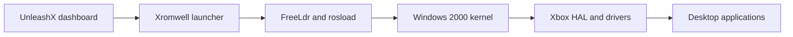

# How the project works

The original Xbox is an x86 computer whose hardware and boot conventions differ
from a PC. This project supplies adaptations that let Windows 2000 use that
hardware; it does not replace the Windows kernel.

## Boot path

The dashboard starts an XBE. The Cromwell-derived launcher sets up the selected
video timing and boot environment. The ReactOS-derived loader locates Windows
and supplies its handoff. Xbox HAL and driver changes handle the platform.

Launcher, loader, HAL, boot video, miniport and display driver must agree on the
framebuffer reservation, address, dimensions, stride and cache behavior. A mode
is therefore a matched boot profile, not just a desktop setting.

## Storage and display

The FATX driver implements Windows file, directory, allocation, cache and paging
operations on Xbox partitions. Recent work fixes duplicate directory results
and CMD copy/move behavior. Tests compare saved contents and allocation state
after shutdown, rather than relying on successful API returns. This does not
format the disk as NTFS. See [partition mapping](installation.md).

The display driver draws with the CPU and updates the framebuffer. Software
copy, text, bounds and transfer paths have been investigated. At 720p, the user
confirmed clean text and full-window dragging. 1080i presentation remains open.
The working demo contains no experimental GPU ownership or acceleration code.

AC'97 integration provides audible login sounds and test tones. Exact stereo
routing and broad audio compatibility remain unconfirmed.

## Project contributions

- Xbox boot/Windows handoff adaptations, partition selection and coordinated HD
  framebuffer reservation.
- FATX compatibility and persistence fixes validated with file readback.
- Software display and handoff changes, desktop preferences and mode configuration.
- Audio integration and an assembled desktop demo.
- Source/build identification, emulator diagnostics, hardware records, cold
  filesystem checks and private recovery packaging.

The [source map](../src/README.md) shows maintained files. The
[development guide](development.md) distinguishes test scopes and remaining work.
