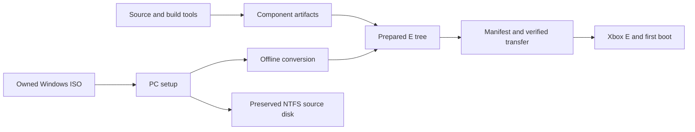

# From a component build to a bootable Xbox

Use this guide after [building the components](building.md). It explains which
files you have, how Windows must be prepared, and how a prepared installation
is copied and started. Commands run on your PC from the repository root unless
stated otherwise. The shell examples use Linux/WSL and Python 3.12 or newer.

**A successful build produces drivers and bootloaders, not a Windows installation.**
The project has booted a clean-media assembly in xemu and a separate prepared
demo on physical hardware. It does not yet have a portable, lossless clean
installer: registry conversion needs packaging, and six paths from the tested
Windows installation exceed FATX's name limit. These are project limitations,
not missing permissions on your PC.

## Choose your starting point

| What you have | Next step |
|---|---|
| Only compiled component binaries | Prepare your own Windows installation, starting at step 2 below |
| A Windows ISO | Verify the media, install Windows on a disposable PC VM, then prepare it for Xbox |
| An ordinary installed PC Windows directory | Preserve the source disk; do not FTP it directly to the Xbox |
| A matched, prepared E/720p package with its manifest and installation prerequisites | Verify it, then follow steps 4–6; package integrity alone does not qualify a new console |
| The existing configured demo | Use the [demo boot instructions](installation.md#already-configured-demo) |

The workflow is:



Do not jump from component artifacts or PC setup directly to the FTP step.

## 1. Collect the complete component set

The [build guide](building.md) defines `DEPS`, `BOOTSTRAP`, `CACHE` and `ROSBE`.
Set them again if you opened a new terminal. Each profile needs a fresh output
directory outside the repository, dependency cache and toolchain. To build the
seven ReactOS-based profiles after dependency setup:

```sh
DEPS="$HOME/xwn-dependencies-001"
BOOTSTRAP="$HOME/xwn-rosbe-001"
CACHE="$DEPS/reactos"
ROSBE="$BOOTSTRAP/RosBE-2.2.1"
BUILD_ROOT="$HOME/xwn-components-001"

# BUILD_ROOT must be a new location; do not reuse a failed build's output.
for profile in fatx framebuffer loader display audio hal network; do
    python3 tools/xwn.py build --profile "$profile" \
        --cache "$CACHE" --rosbe "$ROSBE" \
        --toolchain-receipt "$BOOTSTRAP/toolchain.json" \
        --output "$BUILD_ROOT/$profile" || break
done
```

Check every profile's result before continuing. A stopped loop leaves later
profiles unbuilt. If you already built a profile successfully, retain its
artifacts and receipts; build only the missing profiles in fresh directories.
Build the separate E/720p launcher with its documented GCC 12 toolchain:

```sh
python3 tools/xwn.py build --profile launcher \
    --cache "$DEPS/cromwell" --gcc12 /usr/bin/gcc-12 \
    --output "$BUILD_ROOT/launcher"
```

The ten outputs are under each profile's `artifacts/` directory. Keep
`build.json`, `source.json`, the build command and log with them. The destination
column below describes the **prepared E layout**, not permission to overwrite
files in an existing installation.

| Profile | Artifact | Destination relative to dashboard E |
|---|---|---|
| launcher | `default.xbe` | `Applications/XWNEBoot/default.xbe` |
| loader | `freeldr.sys` | `Applications/XWNEBoot/freeldr.sys` |
| loader | `rosload.exe` | `Applications/XWNEBoot/rosload.exe` |
| hal | `halxboxnt5.dll` | `Applications/XWNEBoot/loader/halxboxnt5.dll` |
| framebuffer | `xboxbvid.dll` | `Applications/XWNEBoot/loader/xboxbvid.dll` |
| framebuffer | `xboxvnt5.sys` | `WINNT/system32/drivers/xboxvnt5.sys` |
| fatx | `xwnfatx.sys` | `WINNT/system32/drivers/xwnfatx.sys` |
| display | `xwnown.dll` | `WINNT/system32/xwnown.dll` |
| audio | `xwnaci207.sys` | `WINNT/system32/drivers/xwnaci207.sys` |
| network | `nvnetnt5.sys` | `WINNT/system32/drivers/nvnetnt5.sys` |

The launcher, loaders, HAL and video drivers must agree on partition, resolution
and reserved framebuffer memory. Use E/720p as the initial profile. Copying a
different HAL over the PC's `hal.dll` is not the project's boot procedure.
Loader configuration/support files, Windows dependencies, driver INF packages
and registry preparation are additional inputs, not outputs of these builds.

## 2. Install Windows from your own media

1. Identify the disc with the [media verifier](windows-media.md):

   ```sh
   python3 tools/verify-media.py --iso "/path/to/your/windows-2000.iso"
   ```

2. Use a new disposable PC VM disk and the key appropriate to that disc. The
   recorded clean test used a blank 2 GiB disk, 64 MiB RAM, Pentium III CPU,
   legacy IDE, Cirrus display and no network adapter. Complete Windows setup
   and log on. The exact tested disc and VM configuration are in the media guide;
   a generic SP4 label is not an equivalent baseline.
3. Shut Windows down normally. Detach the ISO and any answer floppy, boot from
   the disk alone, log on, then shut down normally again. Record setup errors
   and installed kernel identity before changing anything for Xbox.
4. Preserve that NTFS disk as the authoritative source. Extract its Windows
   files, profiles, application directories and registry into a separate private
   working tree using an offline reader that preserves original names and bytes.
   Include hidden/system files and empty directories. Keep a manifest of paths,
   sizes and SHA-256 hashes, and the extraction tool/version. A mounted, running
   Windows tree is not a consistent offline source.

This is a fresh installation, not a copy of the development console's Windows
directory. Windows files, product keys, profiles and hives remain private.

## 3. Prepare the Windows tree for Xbox

This is the currently incomplete public tooling stage. The successful
[clean assembly experiment](../outputs/fresh-assembly405/REPORT.md) records what
was done, but its scripts reference private fixtures and are not portable setup
commands. Do not run them with guessed paths.

Preparation needs all of the following:

| Work | Required result |
|---|---|
| File-name and capacity preflight | Every source path is representable without renaming or omission; enough space for files, directories and runtime growth |
| Component overlay | The matched files from step 1 plus their loader configuration and support files |
| Windows dependencies | Boot/storage and USB/HID files from the same owned media, with cabinet/member identities; see [provenance](provenance.md) |
| SYSTEM hive conversion | Xbox IDE/FATX boot services, video service/display DLL, USB/HID services and critical-device mappings in the applicable control sets |
| Drive-letter conversion | Verified Xbox E geometry mapped to Windows C; stale PC disk identities must not select the wrong partition |
| Driver installation packages | INF and binary names agree, including `xwnown.dll`; audio/network packages remain available for real Plug and Play installation |
| Registry preservation | Work on copies; record intended changes and preserve all unrelated raw values, including types a decoder does not understand |
| First-boot configuration | Normal desktop startup; diagnostics and automatic restart only when explicitly selected for a test |

There is no universal `.reg` file for these changes: partition geometry, media,
control sets and installed services matter. Do not copy another machine's
SYSTEM/SOFTWARE hives or invent installed-device entries to bypass Plug and Play.

For the tested English installation, export the extraction manifest as a JSON
array with a `path` for every file and directory, relative to the Windows volume:

```json
[
  {"path": "WINNT"},
  {"path": "WINNT/system32"},
  {"path": "WINNT/system32/ntoskrnl.exe"}
]
```

The example only illustrates the format; use your complete manifest:

```sh
python3 tools/fatx_names.py installation-files.json --oemcp 437 > fatx-names.json
```

Exit code 0 means the supplied names passed; exit code 2 means at least one did
not. This checks names, not file contents, extraction completeness or free space.
**Stop if it fails.** The tested clean installation still has six overlong paths,
including cryptographic state. Truncating them, omitting them, or using a different
FTP client does not fix Windows' requests for those names. RSA and user DPAPI
operations have reproduced actual failures; details are in [installation](installation.md).

Two earlier floppy shortcuts fit CP437 and were restored; they are not part of
the six remaining failures. A file-backed NTFS experiment is currently
[read-only host discovery](../outputs/image-discovery429/REPORT.md), not a bootable
Windows storage alternative. Do not format Xbox E as NTFS.

Until a portable converter and lossless storage route are qualified, builders
can reproduce component builds and PC setup, but cannot complete a supported
general clean-console installation from this guide. The remaining steps apply
only to an already prepared, explicitly reviewed payload; they do not waive
this preparation gate.

## 4. Package and verify a prepared payload on the PC

A prepared staging directory has this shape:

```text
staging/
  E/
    WINNT/                         (includes prepared registry and drivers)
    Documents and Settings/        (this installation's profiles)
    Program Files/
    Applications/XWNEBoot/          (matched boot chain and support files)
  docs/                            (stays on the PC)
  host/                            (stays on the PC)
```

The package tool's Windows allowlist covers these four installation roots.
Extra demo/driver directories outside them need a reviewed layout change; do
not silently leave them out to make packaging succeed. Keep manifests and ZIPs
outside staging, and use fresh output filenames:

```sh
python3 tools/tester_bundle.py plan --kind windows-e-preview \
    --root staging --output windows-plan.json
python3 tools/tester_bundle.py build --root staging \
    --manifest windows-plan.json --output windows-preview.zip --private-windows
python3 tools/tester_bundle.py verify windows-preview.zip
```

Inspect the plan before building. The private-Windows flag acknowledges package
contents; it does not establish redistribution rights or turn a PC tree into a
bootable Xbox installation. The tool verifies integrity and basic layout, not
registry semantics, free space, bootability or recovery. See [bundle details](tester-bundles.md).

## 5. Copy to dashboard E, then read it back

Use this step only when the package prerequisites match the console and its
installation/recovery procedure has been reviewed. Keep the console at UnleashX
throughout the transfer.

1. Back up the existing target and preserve dashboard C, EEPROM/recovery data,
   and E's `Apps`, `Applications`, `TDATA` and `UDATA`. Check E's free space against
   the package and its specified runtime reserve. Do not format or repartition.
2. Stop on collisions with `WINNT`, `Documents and Settings`, `Program Files`,
   or `Applications/XWNEBoot`. An existing installation requires its own matched
   update/rollback plan; choosing “overwrite all” is not a fresh install.
3. Extract the verified ZIP locally. With your FTP client in **binary mode**,
   upload the **contents of its `E/` folder into dashboard `E:\`**. For example,
   `staging/E/WINNT` becomes `E:\WINNT`, not `E:\E\WINNT`. Preserve empty
   directories. Leave `Applications/XWNEBoot/default.xbe` out for now. Do not
   upload PC-only docs, source, manifests or host tools to the console.
4. Download the uploaded package paths into a new PC directory, keeping the
   `E/` prefix, for example `readback/E/WINNT`. Include required empty directories
   but no unrelated console files. Compare against the original ZIP:

   ```sh
   python3 tools/tester_bundle.py verify-tree windows-preview.zip \
       --root readback --console-only --defer-launcher
   ```

5. If that passes, upload `default.xbe` last, download it into the same readback
   tree, and repeat without `--defer-launcher`:

   ```sh
   python3 tools/tester_bundle.py verify-tree windows-preview.zip \
       --root readback --console-only
   ```

Do not launch after a failed comparison. Resolve the failed transfer and verify
again. These commands neither FTP files nor reboot the Xbox. The historical
`install-stock-e.py` and `package-stock-e.py` tools are private-baseline migration
tools, not substitutes for the missing clean installer.

## 6. First boot, device setup and acceptance

Connect a known-working mouse before boot. From **UnleashX File Explorer**, open
`E:\Applications\XWNEBoot\default.xbe`. Record whether Xromwell and then Windows
appear. Do not rely on a dashboard menu item to choose the intended profile.

The initial configuration is E/720p. On the tested mapping, dashboard E is
Windows C, while dashboard C appears as Windows F: **leave Windows F alone**.
Verify the mapping for each new configuration. Do not change to 1080i for the
first boot; its visual issue is unresolved.

Use the prepared package's matching INF locations for audio, network and display
installation through Windows Plug and Play. Allow software-audio setup to finish
and restart normally before testing sound. Copying a `.sys` file alone does not
install the device. Record the exact name of unsupported-device wizards; do not
disable devices or suppress events to claim a clean install.

Before calling the installation usable, check:

- Clean text, mouse/keyboard response, Notepad editing/saving, Paint and dragging.
- Sound with an audible test, and a network transfer with independent readback.
- Windows **Start → Shut Down → Restart**, dashboard return, and a second boot
  with saved files intact. A forced reset is a different result.
- Registry/event and filesystem checks appropriate to the installation. The
  historical Ftdisk 49 failure remains unresolved even when the desktop works.

Keep the package hash, component receipts, hardware/encoder report, observed
boot route, errors and rollback location with the result. Follow
[tester reporting](testers.md) and [recovery](recovery-guide.md). Offline image
backup/restore has separate evidence; it is not proof of physical FTP recovery.
